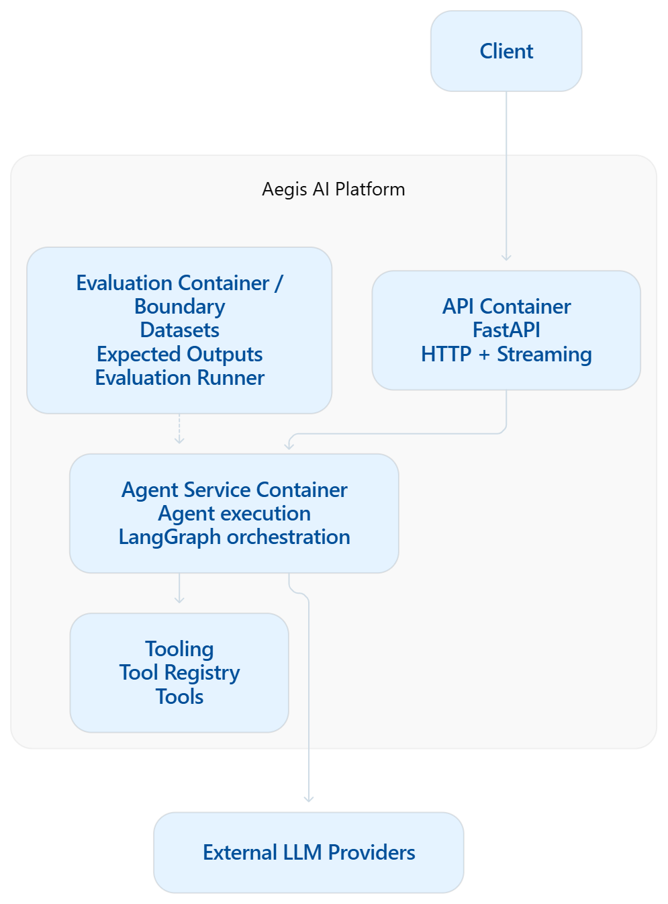
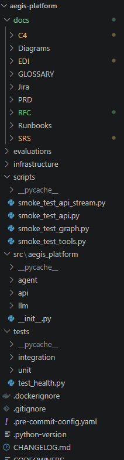

# AEGIS-C4-001
>Context Container Component Code - This documentation talks about the architecture review.How is it structured?

>Context - System Boundaries, Container - Application Building blocks.
# C4 Architecture – Level 1 & Level 2  & Level 3 & Level 4

**Version:** 1.8
**Status:** Active
**Owner:** Kader Beevi
**Last Updated:** 2026-11-15

## Related Artifacts

- PRD: AEGIS-PRD-001
- RFC-001: Platform Foundation
- RFC-002: FastAPI Foundation
- RFC-006: Multi-Provider Support
- RFC-009: RAG Architecture
- SRS: AEGIS-SRS-001
- ADR: AEGIS-ADR-001
- ADR: AEGIS-ADR-006
- ADR: AEGIS-ADR-009 (RAG Chunking, Embedding Provider, Vector Store - Phase 1 & 2)
- EDI: AEGIS-EDI-001

---

# Revision History

| Version | Date | Changes |
|----------|------|---------|
| 1.0 | 2026-09-27 | Initial platform architecture. |
| 1.1 | 2026-09-28 | Added FastAPI Gateway as the primary API entry point. |
| 1.2 | 2026-09-29 | Added LangGraph orchestration layer. |
| 1.5 | 2026-10-18 | Documented factory selection of NVIDIA or OpenAI adapters while preserving the agent execution path. |
| 1.7 | 2026-11-15 | Added RAG Retriever container with LangChain-based chunking foundation. |
| 1.8 | 2026-11-15 | Added Phase 2 EmbedderService (OpenAI) and VectorStoreService (Qdrant) containers; updated container diagram with DAG flow; added decision references ADR-010 and ADR-011. |

---

# Purpose

This document describes the high-level architecture of Aegis AI Platform using the C4 Model.

Current implementation focuses on:

- FastAPI Gateway
- Python foundation
- AgentService and LangGraph execution path
- Provider-neutral LLM interface and provider factory
- NVIDIA adapter as the default provider and OpenAI as an alternative
- **RAG Retriever container (Phase 1):** LangChain-based chunking foundation
- **RAG Embedder service (Phase 2):** OpenAI text-embedding-3-small provider
- **RAG VectorStore service (Phase 2):** Qdrant vector database integration

---

# Level 1 — System Context

AEGIS requires operational visibility across multiple LLM providers without coupling observability to individual provider SDKs.

## Actors

- End User
- Administrator
- Future AI Client
- External LLM Providers (NVIDIA, OpenAI)
- External Embedding Providers (OpenAI text-embedding-3-small)
- External Vector Stores (Qdrant)

## Context Diagram

```text
                 +----------------------+
                 |      End User        |
                 +----------+-----------+
                            |
                            v
        +-------------------------------------------+
        |         Aegis AI Platform                  |
        |-------------------------------------------|
        | FastAPI Gateway                           |
        | AI Agent Platform                         |
        | RAG Retrieval (Chunking + Embedding)      |
        | Observability                             |
        | Reliability                             |
        | Future Event Processing                   |
        +----------------+--------------------------+
                         |
         +---------------+-------+-------------------+
         |                       |                   |
         v                       v                   v
+------------------+  +-------------------+   +-----------+
| NVIDIA/OpenAI    |  | OpenAI Embedding  |   | Qdrant    |
| LLM APIs         |  | API (Phase 2)     |   | VectorDB  |
|                  |  | (text-embedding-  |   | (Phase 2) |
|                  |  |  3-small)         |   |           |
+------------------+  +-------------------+   +-----------+
```

---

# Level 2 — Container Diagram

The platform is organized into independently deployable containers.



---

# Container Responsibilities

| Container | Responsibility |
|------------|---------------|
| FastAPI Gateway | Entry point, validation, OpenAPI, health endpoints |
| Agent Service | LangGraph orchestration |
| Retriever | RAG retrieval with LangChain-based text chunking (Phase 1 - COMPLETE) |
| Embedder Service | OpenAI text-embedding-3-small provider (Phase 2 - IN PROGRESS) |
| VectorStore Service | Qdrant vector database integration (Phase 2 - IN PROGRESS) |
| Evaluation | AI evaluation (future) |
| PostgreSQL | Metadata storage (future) |

```text
Application startup:
  Configuration -> LLMProviderFactory -> selected LLM adapter
                         (NVIDIA default; OpenAI alternative)
                                  |
                                  +---- injected into AgentService

  Configuration -> EmbeddingProviderFactory -> OpenAI text-embedding-3-small
                         (Phase 2)  |
                                  +---- injected into EmbedderService

  Configuration -> VectorStoreFactory -> Qdrant
                         (Phase 2)  |
                                  +---- injected into VectorStoreService

RAG Retrieval Request Flow (Phase 2):
  User Document -> Chunker (Phase 1) -> Chunks
                                          |
                                          +-----> EmbedderService (OpenAI)
                                                    |
                                                    +---> Dense Vectors
                                                            |
                                                            +-----> VectorStoreService (Qdrant)
                                                                      |
                                                                      +---> Upsert & Persist

Query Retrieval Flow (Phase 2):
  User Query -> Chunker -> Chunks
                   |
                   +-----> EmbedderService (OpenAI)
                             |
                             +---> Query Vector
                                     |
                                     +-----> VectorStoreService (Qdrant)
                                               |
                                               +---> Search & Retrieve
                                                       |
                                                       +---> Top-K Results

Agent Execution Flow (existing):
  Client -> FastAPI -> AgentService -> LangGraph -> LLMProvider interface
                                                    -> selected adapter
                                                        -> NVIDIA API
                                                        -> OpenAI API
                                                  -> Reliability Wrapper
```

---

# Level 3 - Component Diagram


## Component Responsibilities

| Component | Responsibility |
|---|---|
| Agent Service | Agent orchestration and application-level execution |
| Chunker | Text segmentation with configurable strategies |
| Embedder Service | OpenAI text-embedding-3-small provider (Phase 2) |
| VectorStore Service | Qdrant vector storage and retrieval (Phase 2) |
| ObservedLLMProvider | Logical request metrics and structured events |
| RetryingLLMProvider | Retry policy and retry callback |
| Provider Adapter | Provider SDK integration |
| Metrics Sink | Vendor-neutral metric recording |
| Event Sink | Structured event recording |

## Component Flow

```text
Agent Service
     |
     v
ObservedLLMProvider
     |
     +------> Metrics Sink
     |
     +------> Event Sink
     |
     v
RetryingLLMProvider
     |
     +------> Retry Telemetry Callback
     |
     v
Concrete Provider
     |
     +------> OpenAI
     |
     +------> NVIDIA
```

## 4. Trust Boundaries

Telemetry is treated as a separate data flow.

Sensitive request and response content must not cross into telemetry sinks.

## 5. Future Extensions

The metrics and event interfaces may later be implemented using:

- OpenTelemetry
- Prometheus
- Grafana
- Centralized structured logging

---

# Level 4 - Code Tree




---

# Current Implementation Scope

The current implementation includes:

- FastAPI Gateway and health endpoints
- AgentService and LangGraph execution path
- Provider-neutral LLM interface and provider factory
- NVIDIA adapter as the default provider and OpenAI as an alternative
- Configuration-driven models, timeouts, and provider credentials
- Provider Reliability Wrapper
- **RAG Retriever container (Phase 1):** Chunking strategies with LangChain-based implementation, abstract protocols for EmbeddingProvider and VectorStore, configuration-driven dependency injection

Other future containers remain planned until their respective RFCs are implemented.

---

# Architecture Principles

This architecture follows:

- Documentation First
- Event-Driven Thinking
- Observability Built In
- Cloud Neutral Architecture
- Reliability Over Cleverness

These principles are defined in `docs/ARCHITECTURE/PRINCIPLES.md`.

---

# Traceability

| Artifact | Purpose |
|----------|---------|
| RFC-002 | FastAPI proposal |
| RFC-006 | Multi-provider requirements and acceptance criteria |
| RFC-009 | RAG architecture proposal |
| ADR-001 | FastAPI decision |
| ADR-006 | NVIDIA default and OpenAI alternative decision |
| ADR-009 | RAG chunking strategy decision |
| SRS-001 | Software requirements (includes RAG foundation section) |
| EDI-001 | Decision and multi-provider evidence traceability |
| EPIC-002 | Implementation |
