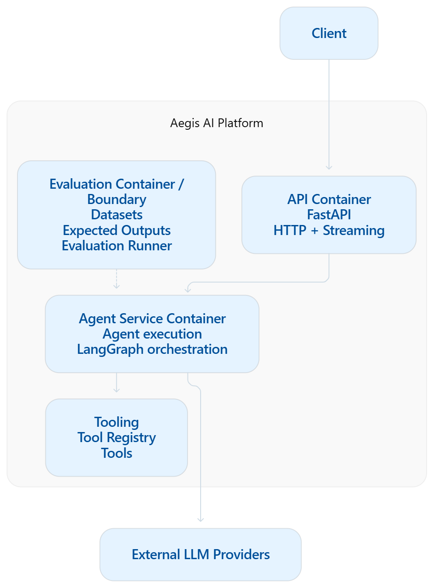
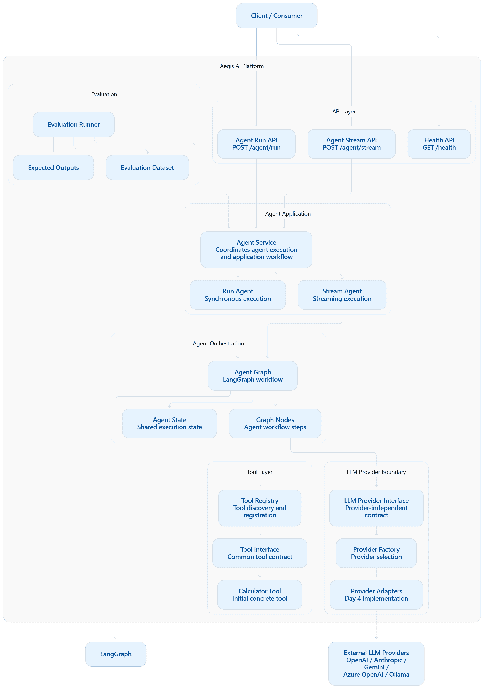
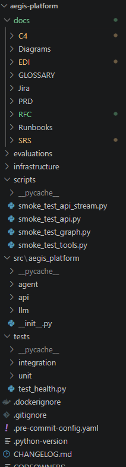

# AEGIS-C4-001
>Context Container Component Code - This documentation talks about the architecture review.How is it structured?

>Context - System Boundaries, Container - Application Building blocks.
# C4 Architecture – Level 1 & Level 2  & Level 3 & Level 4

**Version:** 1.5
**Status:** Active
**Owner:** Kader Beevi
**Last Updated:** 2026-10-18

## Related Artifacts

- PRD: AEGIS-PRD-001
- RFC-001: Platform Foundation
- RFC-002: FastAPI Foundation
- RFC-006: Multi-Provider Support
- SRS: AEGIS-SRS-001
- ADR: AEGIS-ADR-001
- ADR: AEGIS-ADR-006
- EDI: AEGIS-EDI-001

---

# Revision History

| Version | Date | Changes |
|----------|------|---------|
| 1.0 | 2026-09-27 | Initial platform architecture. |
| 1.1 | 2026-09-28 | Added FastAPI Gateway as the primary API entry point. |
| 1.2 | 2026-09-29 | Added LangGraph orchestration layer. |
| 1.5 | 2026-10-18 | Documented factory selection of NVIDIA or OpenAI adapters while preserving the agent execution path. |

---

# Purpose

This document describes the high-level architecture of Aegis AI Platform using the C4 Model.

Current implementation focuses on:

- FastAPI Gateway
- Python foundation
- AgentService and LangGraph execution path
- Provider-neutral LLM interface and provider factory
- NVIDIA adapter as the default provider and OpenAI as an alternative

---

# Level 1 — System Context

## Actors

- End User
- Administrator
- Future AI Client
- External LLM Providers (NVIDIA and OpenAI)

## Context Diagram

```text
                 +----------------------+
                 |      End User        |
                 +----------+-----------+
                            |
                            v
        +-------------------------------------------+
        |         Aegis AI Platform                  |
        |-------------------------------------------|
        | FastAPI Gateway                           |
        | AI Agent Platform                         |
        | Observability                             |
        | Future Event Processing                   |
        +----------------+--------------------------+
                         |
         +---------------+---------------+
         |                               |
         v                               v
+------------------+           +----------------------+
| NVIDIA API       |           | Future Vector DB     |
| OpenAI API       |           | (Qdrant)             |
+------------------+           +----------------------+
```

---

# Level 2 — Container Diagram

The platform is organized into independently deployable containers.



---

# Container Responsibilities

| Container | Responsibility |
|------------|---------------|
| FastAPI Gateway | Entry point, validation, OpenAPI, health endpoints |
| Agent Service | LangGraph orchestration |
| Retriever | RAG retrieval (future) |
| Evaluation | AI evaluation (future) |
| PostgreSQL | Metadata storage (future) |
| Qdrant | Vector search (future) |

```text
Application startup:
  Configuration -> LLMProviderFactory -> selected adapter
                         (NVIDIA default; OpenAI alternative)
                                  |
                                  +---- injected into AgentService

Request execution:
  Client -> FastAPI -> AgentService -> LangGraph -> LLMProvider interface
                                                    -> selected adapter
                                                        -> NVIDIA API
                                                        -> OpenAI API

  LangGraph -> Tool Registry -> Calculator Tool
```

---

# Level 3 - Component Diagram



Current Architecture — Simplified View

```mermaid
flowchart TD
    Client --> API[FastAPI endpoints]
    API --> Service[AgentService]
    Service --> Graph[LangGraph]
    Graph --> ProviderContract[LLMProvider interface]
    Graph --> Registry[Tool Registry]
    Registry --> Calculator[Calculator Tool]

    Settings[Provider settings] --> Factory[LLMProviderFactory]
    Factory -->|default| Nvidia[NVIDIA adapter]
    Factory -->|configured alternative| OpenAI[OpenAI adapter]
    Nvidia -. implements .-> ProviderContract
    OpenAI -. implements .-> ProviderContract
    Nvidia --> NvidiaAPI[NVIDIA API]
    OpenAI --> OpenAIAPI[OpenAI API]
    Evaluation[Evaluation framework (planned)] --> Dataset[Evaluation dataset]
    Evaluation --> Runner[Evaluation runner]
```

---

# Level 4 - Code Tree




---

# Current Implementation Scope

The current implementation includes:

- FastAPI Gateway and health endpoints
- AgentService and LangGraph execution path
- Provider-neutral LLM interface and provider factory
- NVIDIA adapter as the default provider and OpenAI as an alternative
- Configuration-driven models, timeouts, and provider credentials

Other future containers remain planned until their respective RFCs are implemented.

---

# Architecture Principles

This architecture follows:

- Documentation First
- Event-Driven Thinking
- Observability Built In
- Cloud Neutral Architecture
- Reliability Over Cleverness

These principles are defined in `docs/ARCHITECTURE/PRINCIPLES.md`.

---

# Traceability

| Artifact | Purpose |
|----------|---------|
| RFC-002 | FastAPI proposal |
| RFC-006 | Multi-provider requirements and acceptance criteria |
| ADR-001 | FastAPI decision |
| ADR-006 | NVIDIA default and OpenAI alternative decision |
| SRS-001 | Software requirements |
| EDI-001 | Decision and multi-provider evidence traceability |
| EPIC-002 | Implementation |
